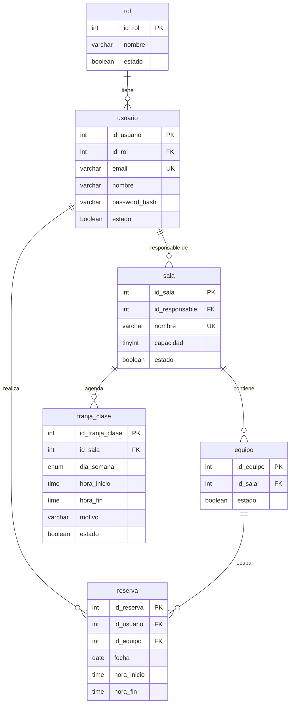
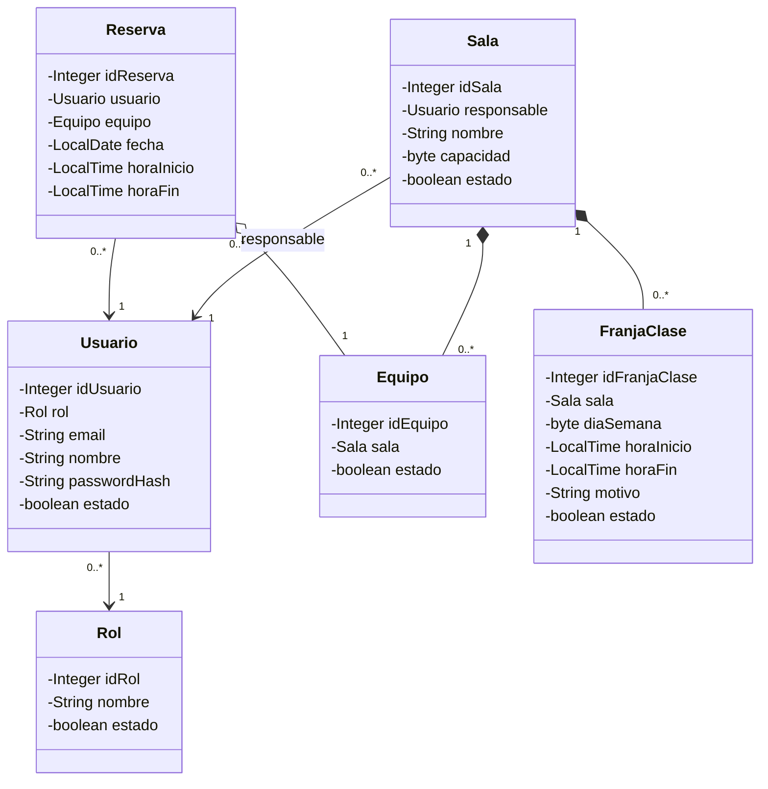

# MiCompu · API REST de gestión de salas de cómputo (UNAB)

<p align="center">
  
  
  
  
</p>

Proyecto académico: API REST para la gestión de las salas de cómputo de la UNAB — roles, usuarios, salas, equipos, reservas y franjas de clase — sobre MySQL, con una interfaz web ligera incluida.

El acceso a datos es **100 % JDBC nativo** (`DriverManager` y SQL a mano): sin JPA/Hibernate.

## Stack tecnológico

| Capa | Tecnología |
|---|---|
| Lenguaje | Java 21 |
| Framework | Spring Boot 4.1.1 (Web MVC, JDBC, Security, Validation, Thymeleaf) |
| Base de datos | MySQL vía Connector/J |
| Entidades | POJOs con Lombok |
| Frontend | HTML/CSS + Vanilla JS (módulos ES) servidos desde `static/` |

## Arquitectura

Paquetes en capas: `controller` → `service` → `repository`, con `entity` y `config` de soporte.

- **`controller`** — Controladores REST bajo `/api` y `ManejadorErrores`, con contrato de errores fijo: `IllegalArgumentException`→400, `NoSuchElementException`→404, `IllegalStateException`→409, `SQLException`→500.
- **`service`** — Reglas de negocio. Abre la `Connection`, maneja transacciones manuales (`setAutoCommit(false)` / `commit` / `rollback`) y ensambla las relaciones entre entidades. `ValidadorReservas` implementa las validaciones de reservas.
- **`repository`** — Un repositorio por tabla; reciben la `Connection` como primer argumento. `ConexionBD` abre conexiones con `DriverManager`.
- **`entity`** — POJOs Lombok (`@Data`, `@Builder`).
- **`config`** — `ConfiguracionReservas` (parámetros del curso, sobrescribibles en arranque con `reservas.*`) y `ConfiguracionSeguridad` (BCrypt + cadena de filtros provisional).

## Diagrama entidad–relación



Notas del esquema (ver [DDL.sql](DDL.sql)):

- Todas las FK son `ON UPDATE CASCADE ON DELETE RESTRICT`.
- La columna `estado` implementa **borrado lógico**: los DELETE son `UPDATE … SET estado = FALSE`. La única excepción es `reserva` (sin columna `estado`), cuyo borrado es físico.

## Diagrama de clases (UML)



Tipos de relación (según el modelado documentado en las entidades):

- **Asociación** (`-->`): `usuario→rol`, `sala→responsable`, `reserva→usuario`.
- **Agregación** (`o--`): `reserva→equipo`.
- **Composición** (`*--`): `equipo→sala` y `franja_clase→sala`.

## Reglas de negocio

Cada solicitud de creación de reserva pasa por **15 validaciones** en orden:

### Fase 1 — Validaciones locales

| # | Regla | Método |
|---|-------|--------|
| 1 | Fecha no anterior al inicio del semestre | `validarFechaInicioSemestre` |
| 2 | Fecha no está en el pasado | `validarFechaNoPasada` |
| 3 | No excede la anticipación máxima (`maxDiasAnticipacion`) | `validarDiasAnticipacion` |
| 4 | Fecha no posterior al cierre del semestre | `validarFechaCierreSemestre` |
| 5 | Día de la semana no bloqueado (`diasBloqueados`, p. ej. sábado/domingo) | `validarDiaNoBloqueado` |
| 6 | Fecha no está en `fechasBloqueadas` (festivos) | `validarFechaNoBloqueada` |
| 7 | Hora de inicio ≥ `horaApertura` (08:00) | `validarHoraApertura` |
| 8 | Hora de fin ≤ `horaCierre` (20:00) | `validarHoraCierre` |
| 9 | Duración ≥ `minDuracionMinutos` (30 min) | `validarDuracionMinima` |
| 10 | Duración ≤ `maxDuracionHoras` (4 h) | `validarDuracionMaxima` |
| 11 | No se cruza con el bloque de almuerzo `[13:00, 14:00)` | `validarBloqueAlmuerzo` |

### Fase 2 — Validaciones contra la base de datos

| # | Regla | Método |
|---|-------|--------|
| 12 | No se cruza con franjas de clase activas de la sala | `validarFranjaDeClase` → `FranjaClaseRepository.existsSolapada` |
| 13 | El equipo está activo (`equipo.isEstado()`) | `validarEquipoActivo` |
| 14 | El usuario tiene menos de `maxReservasActivas` (2) reservas activas | `validarMaximoReservasActivas` → `ReservaRepository.countByUsuarioDesdeFecha` |
| 15 | El equipo no tiene otra reserva solapada en ese horario | `validarReservaSolapada` → `ReservaRepository.existsSolapada` |

## API REST

| Módulo | Endpoints |
|---|---|
| Roles | `GET/POST /api/roles` · `GET/PUT/DELETE /api/roles/{id}` |
| Usuarios | `GET/POST /api/usuarios` · `GET/PUT/DELETE /api/usuarios/{id}` |
| Salas | `GET/POST /api/salas` · `GET/PUT/DELETE /api/salas/{id}` · `GET /api/salas/{id}/equipos` · `GET /api/salas/{id}/franjas` |
| Equipos | `GET/POST /api/equipos` · `GET/PUT/DELETE /api/equipos/{id}` |
| Reservas | `GET/POST /api/reservas` · `GET/PUT/DELETE /api/reservas/{id}` |
| Franjas de clase | `GET/POST /api/franjas-clase` · `GET/PUT/DELETE /api/franjas-clase/{id}` |
| Sesión | `POST /api/sesion` (login) |
| Configuración | `GET /api/configuracion-reservas` (reglas vigentes) |

### Características clave

- **Validaciones de reservas en orden fijo** (15 reglas): semestre, anticipación, días/festivos bloqueados, horario de apertura, duración mínima/máxima, bloque de almuerzo, franja de clase de la sala, equipo activo, máximo de reservas activas y solapamiento.
- **Bloqueo pesimista**: `SELECT … FOR UPDATE` sobre las filas de equipo y usuario (orden fijo) al crear/actualizar reservas, para serializar reservas concurrentes.
- **Convención de intervalos** `[horaInicio, horaFin)`: dos reservas consecutivas que comparten el límite exacto (p. ej. 17:00–18:00 y 18:00–19:00) no se consideran solapadas.
- **Contraseñas con BCrypt**: se cifran antes de guardar y `passwordHash` nunca aparece en las respuestas (`@JsonProperty(WRITE_ONLY)`).
- **`diaSemana` ISO-8601**: 1 = lunes … 7 = domingo.
- Los parámetros de reservas son configurables en caliente y en arranque (`reservas.*`).

## Interfaz web

Páginas servidas desde `src/main/resources/static/`:

- `index.html` — asistente de reserva (fecha → horario → equipo); las reglas se piden vigentes a `GET /api/configuracion-reservas` y no se duplican en el frontend.
- `reservas.html` — mis reservas, con cancelación.
- `login.html` / `register.html` — sesión y registro.

Toda la lógica es Vanilla JS en módulos ES: `js/api.js` es el único cliente REST y `js/reservas.js` concentra el dominio; cada página tiene su script. La sesión del navegador vive en `sessionStorage`.

## Puesta en marcha

**Requisitos:** JDK 21 (con `JAVA_HOME` bien apuntado) y acceso a un MySQL. Maven no es necesario: el wrapper está incluido.

```bash
# 1. Crear el esquema (¡ojo! DDL.sql hace DROP DATABASE y recrea todo)
mysql -u root -p < DDL.sql

# 2. Compilar y probar (el test de contexto corre sin MySQL: las conexiones son perezosas)
./mvnw clean compile
./mvnw test

# 3. Apuntar a la base con variables de entorno y arrancar
DB_URL='jdbc:mysql://localhost:3306/mi_compu_unab?sslMode=DISABLED&allowPublicKeyRetrieval=true' \
DB_USER=tu_usuario \
DB_PASSWORD=tu_clave \
./mvnw spring-boot:run
```

La app queda en `http://localhost:8080`: la API bajo `/api` y la interfaz web en `/`.

La conexión se configura en `application.properties` (`db.url`, `db.usuario`, `db.clave`) y se sobrescribe con `DB_URL`, `DB_USER` y `DB_PASSWORD`. En Windows, usar `mvnw.cmd`.

## Estructura del proyecto

```
micompu/
├── DDL.sql                         # Esquema MySQL (6 tablas)
├── pom.xml
└── src/main/
    ├── java/co/edu/unab/micompu/
    │   ├── MiCompuApplication.java
    │   ├── config/                 # ConfiguracionReservas · ConfiguracionSeguridad
    │   ├── controller/             # Controladores REST + ManejadorErrores
    │   ├── service/                # Negocio, transacciones, ValidadorReservas
    │   ├── repository/             # JDBC nativo (DriverManager + ConexionBD)
    │   └── entity/                 # POJOs Lombok
    └── resources/
        ├── application.properties  # Conexión db.* y parámetros reservas.*
        └── static/                 # Interfaz web (HTML + CSS + JS vanilla)
```

## ¿Preguntas?

<p align="center">
  <a href="https://deepwiki.com/EmmanuelSan01/micompu"></a>
</p>
